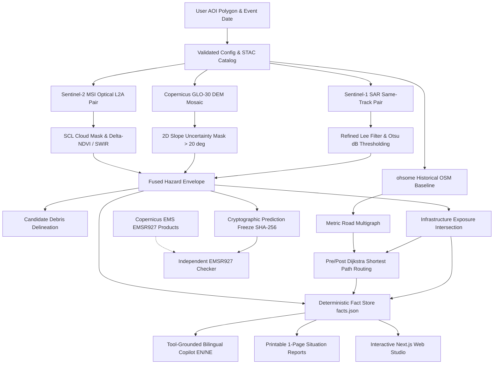

# Orbiq 🛰️🌊

**Multi-Sensor Satellite Flood Damage Mapping, Rescue Access Intelligence & Hydrodynamic Decision Studio**

*Multimodal AI Hackathon 2026 — Track B: Mapping Flood Damage from Space*

[](https://python.org)
[](https://fastapi.tiangolo.com)
[](https://nextjs.org)
[](https://leafletjs.com)
[](backend/tests/track_b)
[](THIRD_PARTY_NOTICES.md)

---

## 📌 Executive Summary

**Orbiq** is an end-to-end Earth Observation and post-disaster spatial intelligence system designed for rapid flood damage assessment and rescue routing in complex Himalayan and river basin terrains.

When catastrophic flood events strike, cloud cover frequently blinds optical satellites, mountain topography creates radar shadows mimicking standing water, and road networks become impassable. Orbiq addresses these challenges through a physically grounded, leak-proof Earth Observation and network topology pipeline:

1. **Synthetic Aperture Radar (SAR) Invariants:** Rigid same-track (~12-day repeat) Sentinel-1 pair matching enforcing identical relative orbits, look angles, and acquisition modes to isolate genuine surface change.
2. **Topographic Uncertainty Masking:** 2D finite-difference slope filtering (`> 20°`) using Copernicus GLO-30 DEM to eliminate radar shadow and layover false positives in steep mountain gorges.
3. **Multispectral & Candidate Debris Fusion:** Sentinel-2 L2A bottom-of-atmosphere reflectance corroboration, SCL cloud/shadow masking, and $\Delta\text{NDVI} < -0.25$ with SWIR bare-soil analysis along valley flow corridors to delineate sediment and mud debris.
4. **Leak-Proof Pre-Event Asset Baselines:** Extraction of historical OpenStreetMap infrastructure strictly prior to the disaster timestamp via the HeiGIT ohsome API, preventing post-event crowd-sourced map leakage.
5. **Network Access & Cut-Off Settlement Routing:** Full metric multigraph analysis evaluating before-and-after reachability to towns and mapped hospitals under optimistic and precautionary road closure scenarios.
6. **Tool-Grounded Bilingual Situation Copilot (English + Nepali):** Natural language assistance bound to a deterministic, server-side fact store (`reports/facts.json`), actively refusing out-of-scope casualty guesses, structural collapse proofs, or unauthorized evacuation orders.
7. **Post-Inference Independent Validation:** Cryptographic SHA-256 prediction freeze locking all derived outputs before comparison against Copernicus EMS (EMSR927) validation references.
8. **Downstream Flow Path Intelligence (Bonus):** D8 gravitational flow routing and downstream settlement corridor tracing from any user-selected upstream seed point.
9. **Hydrodynamic Dam Break Studio:** 2D Shallow Water Equations simulation (ANUGA), Wflow SCS-CN runoff routing, and interactive mission control dashboard.

---

## 🏛️ System Architecture



---

## 🚀 Quick Start & Rehearsal

### 1. Prerequisites
- Linux / macOS (tested on Linux x86_64)
- Python 3.11+
- Node.js v18+ and npm v9+

### 2. Pre-Flight Environment Doctor
Run the automated environment diagnostic script to verify Python runtime, geospatial libraries (rasterio, geopandas, shapely), ohsome API connectivity, and storage permissions:
```bash
./scripts/track_b_doctor.sh
```

### 3. Automated End-to-End Demo Pipeline
Execute the full demonstration pipeline: runs diagnostics, searches Sentinel-1 same-track pairs, inspects the frozen Trishuli August 2026 case study, and verifies bilingual copilot queries:
```bash
./scripts/track_b_demo.sh
```

### 4. Run Automated Test Suite (29 Tests Passing)
```bash
backend/.venv/bin/pytest backend/tests/track_b
```
All 29 tests execute in ~2.0 seconds covering schemas, catalog pairing, SAR thresholding, slope masking, exposure geometry, graph connectivity, bilingual templating, and anti-leakage freeze.

### 5. Launch the Web Studio
Start both the FastAPI backend (port 8000) and Next.js frontend (port 3000) simultaneously:
```bash
./start.sh
```
- **Track B Satellite Damage Studio:** [http://localhost:3000/track-b](http://localhost:3000/track-b)
- **Hydrodynamic Dam Break Studio:** [http://localhost:3000](http://localhost:3000)
- **Interactive REST API Documentation:** [http://localhost:8000/docs](http://localhost:8000/docs)
- **Track B System Health Status:** [http://localhost:8000/api/track-b/health](http://localhost:8000/api/track-b/health)

---

## 💻 Command-Line Interface (CLI)

The CLI provides reproducible satellite discovery, pipeline execution, report generation, and post-freeze validation:

```bash
cd backend

# 1. Environment & Capability Check
python -m track_b.cli doctor

# 2. Discover Same-Track Satellite Pairs for an AOI
python -m track_b.cli discover \
    --aoi ../examples/track_b/aoi.geojson \
    --event-date 2026-08-26 \
    --timezone Asia/Kathmandu

# 3. Trigger a Complete Analysis Run
python -m track_b.cli run --config ../examples/track_b/case_study.json

# 4. Inspect Run Progress & Stage Milestones
python -m track_b.cli status --run-id <run_id>

# 5. Export Printable Situation Reports (EN / NE)
python -m track_b.cli report --run-id <run_id> --language en --format html
python -m track_b.cli report --run-id <run_id> --language ne --format html

# 6. Post-Freeze Independent EMSR927 Validation
python -m track_b.cli validate --run-id <run_id> --reference-dir data/track_b/validation/emsr927
```

---

## 🛰️ Core Methodological Principles

### 1. Same-Track Sentinel-1 Invariants
Water surface mapping with Synthetic Aperture Radar in mountainous terrain is vulnerable to view-angle discrepancies. Orbiq enforces four rigid pairing invariants:
- **Same Relative Orbit & Direction:** Pre- and post-event acquisitions must share the same orbit number and flight direction (Ascending/Descending).
- **Exact ~12-Day Interval:** Pre-event scene acquired ~12 days prior to post-event scene using the same spacecraft.
- **Speckle Reduction:** Refined Lee filter executed in linear power space prior to dB transformation.
- **Adaptive Thresholding:** Otsu bimodal segmentation in dB backscatter space combined with permanent baseline water subtraction.

### 2. Mountain Radar Shadow Exclusion
Radar pulses cannot illuminate valley faces angled away from the line of sight, creating dark patches often misidentified as water. Using the Copernicus GLO-30 DEM, Orbiq calculates a 2D finite-difference slope mask. All pixels with `slope > 20°` are flagged as **terrain uncertainty** and excluded from flood classification.

### 3. Sentinel-2 Candidate Debris Delineation
Floods in high-gradient mountain rivers transport massive mud and sediment loads. Water-only detectors miss these destructive deposits. Orbiq computes:
- $\text{NDVI} = \frac{\text{NIR} - \text{Red}}{\text{NIR} + \text{Red}}$
- $\Delta\text{NDVI} = \text{NDVI}_{\text{post}} - \text{NDVI}_{\text{pre}} < -0.25$ (vegetation loss)
- SWIR bare-soil reflectance $> 0.15$
- Proximity corridor along DEM-derived valley drainage paths.
Areas meeting these criteria outside standing water are classified as **Candidate Debris**.

### 4. Anti-Leakage Historical OpenStreetMap
Standard routing libraries use live OSM data, which frequently incorporates post-event edits (e.g., users marking damaged bridges), contaminating post-event prediction. Orbiq queries the HeiGIT **ohsome API** with an explicit timestamp strictly prior to the disaster date (e.g. `2026-07-27T09:00:00Z`).

### 5. Road Network Access & Cut-Off Analysis
Unlike standard routing engines that filter out disconnected graph components, Orbiq builds a metric multigraph retaining all isolated components:
- **Baseline Connectivity:** Identifies shortest-path network distances to towns and hospitals before the event.
- **Post-Event Scenarios:**
  - *Optimistic Policy:* Blocks at-grade road segments intersecting confident flood water or debris.
  - *Precautionary Policy:* Additionally blocks bridges intersecting the hazard envelope due to scour/structural uncertainty.
- **Settlement Classification:** Categorizes communities into `access_retained`, `rerouted`, `newly_cut_off`, `already_disconnected`, or `boundary_uncertain`.

### 6. Grounded Bilingual Copilot (EN / NE)
Language generation is strictly decoupled from measurement:
- All numerical figures, areas, lengths, and counts originate from server-computed facts in `reports/facts.json`.
- Natural language queries in English and Nepali are routed to deterministic templates citing exact `fact_ids`.
- **Adversarial Safety Guards:** Actively intercepts and refuses ungrounded questions soliciting casualty counts, structural collapse certifications, or evacuation orders.

### 7. Cryptographic Prediction Freeze & Validation Quarantine
To ensure scientific integrity:
- Once analysis completes, all outputs in `derived/` are hashed with SHA-256 and locked into `prediction_freeze.json`.
- Validation tools for Copernicus EMS ([EMSR927](https://mapping.emergency.copernicus.eu/activations/EMSR927/)) reside in an isolated module. Reference products cannot enter prediction pipelines or tune thresholds.

---

## 📊 Trishuli Basin Case Study (August 2026)

- **Run ID:** `run_20261014_165946_2a3de6`
- **Location:** Trishuli River Basin, Nuwakot / Rasuwa, Nepal (`[85.12, 27.92, 85.28, 28.08]`)
- **Event Date:** 2026-08-26 (`Asia/Kathmandu`)
- **Analysis Grid:** UTM Zone 45N (EPSG:32645), 20 m resolution, 801 × 899 cells.
- **Measured Outputs:**
  - Newly inundated flood water: **0.72 km²** (720,000 m²).
  - Candidate debris along flow corridors: **71.29 km²**.
  - Baseline permanent water: **0.15 km²**.
  - Excluded mountain shadow pixels (`slope > 20°`): **582,498 pixels**.
  - Exposed road ways: **2.39 km** (2,390 m).
  - Priority bridge inspection structures: **1 bridge**.
  - Intersecting building footprints: **0** (in rural boundary).
  - Evaluated settlements: **2 settlements** (retained hospital access under precautionary scenario).
- **Prediction Freeze Hash:** `77de531347a94ac5b7eb5468c788e784c27eae83ff5fa7fc5f60abb95edc40ed`.

---

## 📁 Repository Structure

```text
orbiq/
├── backend/
│   ├── track_b/                # Track B satellite damage mapping & access engine
│   │   ├── schemas.py          # Pydantic v2 data contracts & request schemas
│   │   ├── config.py           # Provider URLs, timeouts, algorithm defaults
│   │   ├── store.py            # Atomic file persistence & SQLite run index
│   │   ├── provenance.py       # Cryptographic SHA-256 prediction freeze
│   │   ├── jobs.py             # Durable 10-stage execution pipeline
│   │   ├── api.py              # FastAPI router mounted under /api/track-b
│   │   ├── cli.py              # CLI commands (doctor, discover, run, report)
│   │   ├── providers/          # STAC S1/S2, Copernicus DEM, ohsome OSM
│   │   ├── geo/                # Grid warp, Lee/Otsu flood, debris, exposure, routing
│   │   ├── copilot/            # Grounded bilingual AI (tools, templates, validators)
│   │   ├── reporting/          # Printable single-page HTML/PDF report generators
│   │   ├── validation/         # Quarantined EMSR927 independent validation
│   │   └── ml/                 # Optional Kuro Siwo model configs & inference adapter
│   ├── src/                    # FastAPI main entry point & dam-break routes
│   ├── hydro/                  # ANUGA hydrodynamic simulation & breach hydrographs
│   ├── tests/track_b/          # Automated test suite (29 tests)
│   └── requirements.txt        # Python dependency baseline
├── frontend/
│   ├── src/app/track-b/        # Track B Next.js studio route (/track-b)
│   ├── src/components/track-b/ # Interactive Leaflet map, layer controls, copilot panel
│   ├── src/app/page.tsx        # Dam break hydrodynamic studio entry page
│   └── package.json            # Node.js dependencies
├── docs/track_b/               # Formal submission documentation & audit logs
│   ├── submission_report.md    # 6-page maximum submission report
│   ├── demo_script.md          # 180-second demo video storyboard
│   ├── demo_recording_checklist.md
│   ├── case_study.md           # Trishuli basin event record
│   ├── methods.md              # Technical formulas & algorithms
│   ├── limitations.md          # Physical boundaries & operational caveats
│   ├── acceptance_results.json # Audit ledger of all 13 gates & test runs
│   └── implementation_log.md   # Chronological development log
├── examples/track_b/           # Validated sample AOIs & case study request configs
├── scripts/                    # Automation utilities
│   ├── track_b_doctor.sh       # Pre-flight environment diagnostics
│   └── track_b_demo.sh         # Rehearsal & automated demonstration script
├── start.sh                    # Unified startup script (backend + frontend)
├── THIRD_PARTY_NOTICES.md      # Mandatory data attributions & licenses
└── README.md                   # This master documentation
```

---

## 📄 Key Deliverables & Documentation

- **Submission Report (<=6 Pages):** [`docs/track_b/submission_report.md`](docs/track_b/submission_report.md)
- **Demo Video Script (180s Storyboard):** [`docs/track_b/demo_script.md`](docs/track_b/demo_script.md)
- **Demo Recording Checklist:** [`docs/track_b/demo_recording_checklist.md`](docs/track_b/demo_recording_checklist.md)
- **Case Study Record (Trishuli August 2026):** [`docs/track_b/case_study.md`](docs/track_b/case_study.md)
- **Technical Methodology Guide:** [`docs/track_b/methods.md`](docs/track_b/methods.md)
- **Operational Boundaries & Limitations:** [`docs/track_b/limitations.md`](docs/track_b/limitations.md)
- **Gate Acceptance Ledger:** [`docs/track_b/acceptance_results.json`](docs/track_b/acceptance_results.json)
- **Implementation & Audit Log:** [`docs/track_b/implementation_log.md`](docs/track_b/implementation_log.md)
- **Third-Party Notices & Attribution:** [`THIRD_PARTY_NOTICES.md`](THIRD_PARTY_NOTICES.md)

---

## ⚖️ Required Data Attributions & Disclaimers

> **Contains modified Copernicus Sentinel data 2026.**  
> **Produced using Copernicus WorldDEM-30 © DLR e.V. 2010–2014 and © Airbus Defence and Space GmbH 2014–2018 provided under COPERNICUS by the European Union and ESA; all rights reserved.**  
> **© OpenStreetMap contributors.**  
> **European Union, Copernicus Emergency Management Service data (for reference validation only).**

**Important Educational Prototype Notice:** Orbiq is an educational post-event assessment research prototype. Satellite spatial intersection identifies physical infrastructure exposure, not confirmed structural destruction, road passability, or operational hospital status. Orbiq does not generate casualty or population displacement estimates, nor does it issue operational evacuation commands.